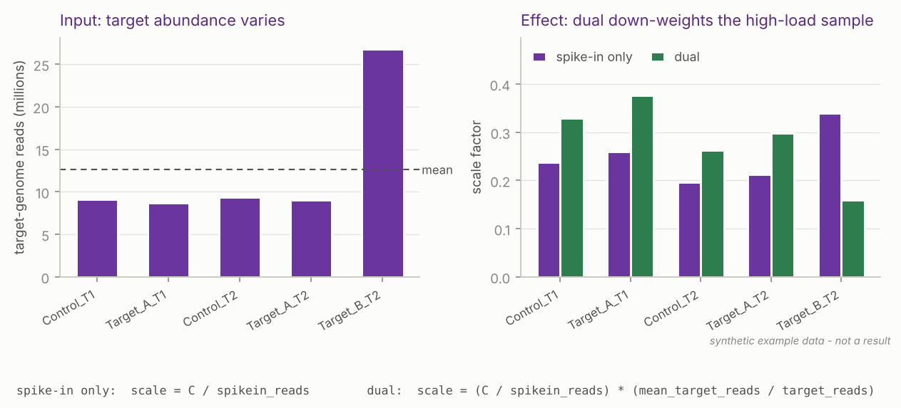
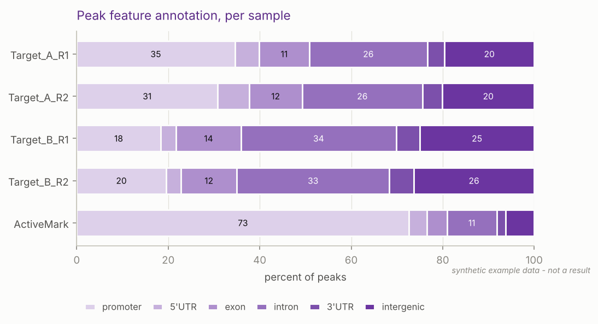
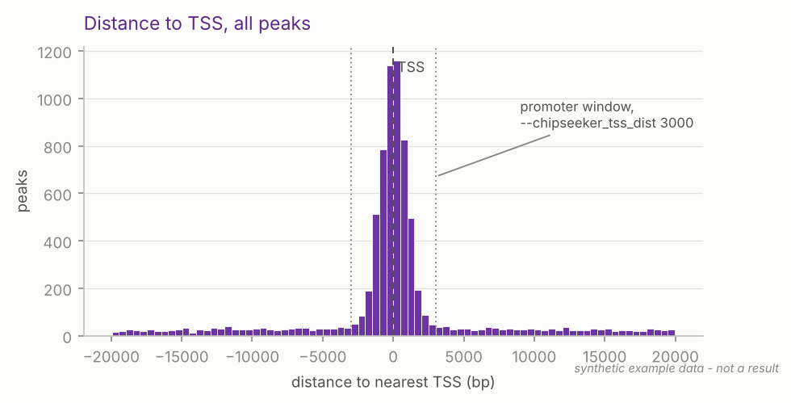
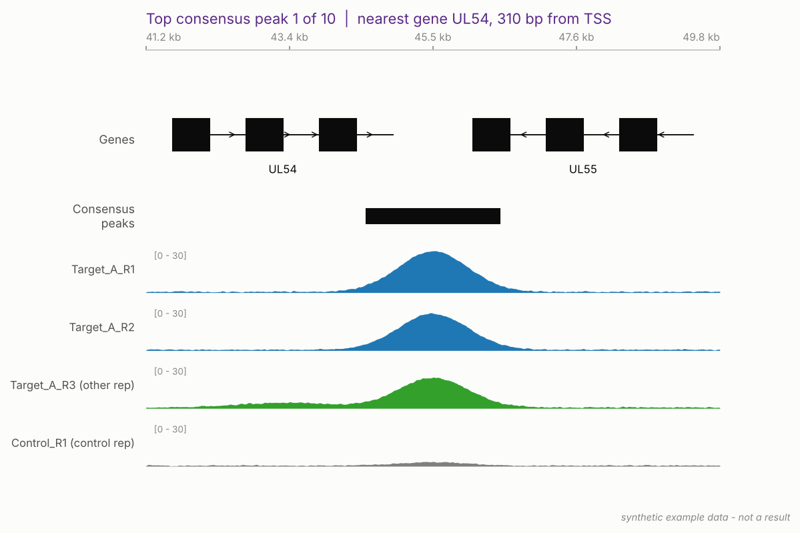
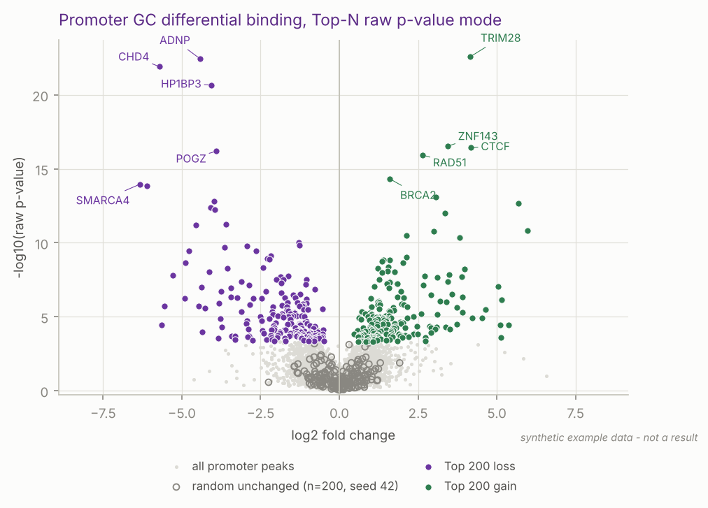
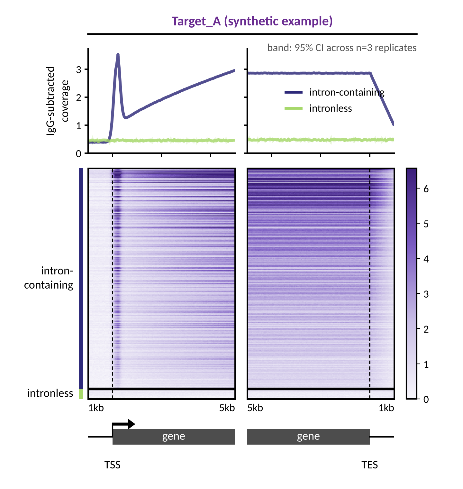

# Custom Modifications to nf-core/cutandrun Pipeline

**Author:** Katharina Hayer (khayer)
**Co-created with:** GitHub Copilot (Claude Sonnet 4.5)

This document tracks custom modifications made to the nf-core/cutandrun pipeline for the Weitzman Lab.

## How I use it:

```bash
# Dual normalization + Homer motifs (HSV17 custom genome)
./nextflow run main.nf \
  --input samplesheet_just2026.csv \
  --outdir results_dual_norm \
  --normalisation_mode Spikein \
  --normalisation_mode_dual true \
  --normalisation_c 10000 \
  -profile singularity \
  --fasta HSV17_genome_files/17_No_repeats.fasta \
  --bowtie2 /home/hayerk/data/index/weitzman_human_hsv/HSV17_genome/ \
  --gene_bed HSV17_from_gff.bed \
  --gtf HSV17_genome_files/17_No_repeats.gff \
  --macs_gsize 136000 \
  -work-dir work_dual_norm \
  --peakcaller macs2 \
  --run_homer_motifs true \
  --skip_multiqc \
  --bigwigcompare_binsize 5 \
  -resume

# Human run
./nextflow run main.nf \
  --input samplesheet.csv \
  --outdir results_human \
  --normalisation_mode Spikein \
  --normalisation_mode_dual true \
  --normalisation_c 10000 \
  -profile singularity \
  -work-dir work_human \
  --peakcaller macs2 \
  --run_homer_motifs true \
  --skip_multiqc \
  --bigwigcompare_binsize 5 \
  --genome hg38

# 33K run with PeakSignalProfiler
nextflow run main.nf \
  --input samplesheet_33K.csv \
  --outdir results_33K \
  --normalisation_mode Spikein \
  --genome GRCh38 \
  --psp_sif ../peak-signal-profiler/psp-1.0.0.sif \
  --run_peak_signal_profiler true \
  --peakcaller macs2 \
  --run_homer_motifs true \
  --bigwigcompare_binsize 5 \
  -profile singularity \
  -work-dir work_33K \
  -resume


# Re-run only peak annotation summary branch (with cache reuse)
module load Java/17.0.6 && nextflow run main.nf \
  --input samplesheet_33K.csv \
  --outdir results_33K \
  --normalisation_mode Spikein \
  --genome GRCh38 \
  --peakcaller macs2 \
  --run_homer_peak_annotation true \
  --run_homer_motifs false \
  --run_peak_signal_profiler false \
  -profile singularity \
  -work-dir work_33K \
  -resume


  ## 2026_04_25
  nextflow run main.nf --input samplesheet_33K.csv --outdir results_33K --normalisation_mode Spikein -profile singularity,slurm -work-dir work_33K --peakcaller macs2 --run_homer_peak_annotation true --run_chipseeker true --run_chipseeker_compare true --publish_frip true --bigwigcompare_binsize 5 --genome hg38 --run_pygenometracks_top10 --blacklist assets/blacklists/hg38-blacklist.bed --run_promoter_gc_diffbind true --promoter_gc_contrasts assets/promoter_gc_contrasts.example_33K.tsv -resume --pygt_peak_flank 5000 --pygt_window_bp 0 --pygt_rank_mode by_feature --pygt_feature_types promoter,TES,UTR,exon,intron,intergenic --pygt_feature_anchor_window 3000

## 2026_05_20
  module load Java/17.0.6 && nextflow run main.nf --input samplesheet_33K.csv --outdir results_human_33K_final --normalisation_mode Spikein -profile singularity,slurm -work-dir work_human_33K_final --peakcaller macs2 --run_homer_peak_annotation true --run_chipseeker true --run_chipseeker_compare true --run_pygenometracks_top10 true --blacklist assets/blacklists/hg38-blacklist.bed --pygt_peak_flank 5000 --pygt_window_bp 0 --pygt_rank_mode by_feature --pygt_feature_types promoter,TES,UTR,exon,intron,intergenic --pygt_feature_anchor_window 5000 --with_report true --genome hg38  -resume --run_deseq2_peak_analysis --deseq2_contrasts assets/promoter_gc_contrasts.example_33K.tsv --with_report true --promoter_gc_contrasts assets/promoter_gc_contrasts.example_33K.tsv
```


module load Java/17.0.6 && nextflow run main.nf --input samplesheet.csv --outdir results_human_final --normalisation_mode Spikein --normalisation_mode_dual true --normalisation_c 10000 -profile singularity,slurm -work-dir work_human_final --peakcaller macs2 --run_homer_peak_annotation true --run_chipseeker true --run_chipseeker_compare true --run_pygenometracks_top10 true --blacklist assets/blacklists/hg38-blacklist.bed --run_promoter_gc_diffbind true --pygt_peak_flank 5000 --pygt_window_bp 0 --pygt_rank_mode by_feature --pygt_feature_types promoter,TES,UTR,exon,intron,intergenic --pygt_feature_anchor_window 5000 --with_report true --genome hg38 --promoter_gc_contrasts assets/promoter_gc_contrasts.example.tsv


## 2026

> Reconstructed 2026-11-23: these lines were outside a code fence and had wrapped mid-token
> (`--run` + `_deseq2_peak_analysis`), so the command could not be copy-pasted. A duplicate
> of the same command was removed. Verify before relying on it.

```bash
module load Java/17.0.6 && nextflow run main.nf \
  --input samplesheet_33K.csv \
  --outdir results_ad5_33K_final \
  --normalisation_mode Spikein \
  -profile singularity,slurm \
  -work-dir work_ad5_33K_final \
  --peakcaller macs2 \
  --run_homer_peak_annotation true \
  --run_chipseeker true \
  --run_chipseeker_compare true \
  --run_pygenometracks_top10 true \
  --pygt_peak_flank 10000 \
  --pygt_window_bp 0 \
  --pygt_rank_mode by_feature \
  --pygt_feature_types promoter,TES,UTR,exon,intron,intergenic \
  --pygt_feature_anchor_window 10000 \
  --gtf Ad5_genome/Ad5_v9.1.Simple_combined.gtf --macs_gsize 100000 \
  --run_deseq2_peak_analysis \
  --deseq2_contrasts assets/promoter_gc_contrasts.example_33K.tsv \
  --with_report true \
  --promoter_gc_contrasts assets/promoter_gc_contrasts.example_33K.tsv \
  --run_homer_motifs true --publish_frip true --run_promoter_gc_diffbind true --fasta Ad5_genome/Adenovirus-Ad5.fasta
```

## Table of Contents
- [Homer Motif Analysis](#homer-motif-analysis)
- [Dual Normalization Feature](#dual-normalization-feature)
- [BigWig Subtraction](#bigwig-subtraction)
- [Merged Peaks Table](#merged-peaks-table)
- [Read Count Annotation](#read-count-annotation)
- [Peak Feature Annotation Plot](#peak-feature-annotation-plot)
- [ChIPseeker Enhanced Visualizations](#chipseeker-enhanced-visualizations)
- [Genome Track Snapshots (pyGenomeTracks)](#genome-track-snapshots-pygenometracks)
- [Promoter GC Differential Binding (Top-N Raw P-value Mode)](#promoter-gc-differential-binding-top-n-raw-p-value-mode)
- [Additional Custom Flags](#additional-custom-flags)
- [Comprehensive HTML Report Generation](#comprehensive-html-report-generation)
- [Species Composition (per-species read counts)](#species-composition-per-species-read-counts)
- [PeakSignalProfiler](#peaksignalprofiler)
- [Split Metagene (TSS / TES, grouped genes)](#split-metagene-tss--tes-grouped-genes)
- [Parameters not yet documented](#parameters-not-yet-documented)
- [Version Information](#version-information)
- [Validation Status](#validation-status)

---

## Homer Motif Analysis

**Date Added:** February 6, 2026
**Purpose:** Perform de novo and known motif discovery in peak regions using Homer

### Background

[Homer](http://homer.ucsd.edu/homer/motif/) (Hypergeometric Optimization of Motif EnRichment) is a comprehensive suite for motif discovery and next-generation sequencing analysis. This integration adds motif finding capabilities to identify:
- **De novo motifs**: Novel transcription factor binding motifs enriched in peaks
- **Known motifs**: Enrichment of previously characterized motifs from databases
- **Motif locations**: Precise positions of motifs within peak regions

Motif analysis is performed on:
1. **Merged peaks** - Combined peak set across all samples
2. **Consensus peaks** - Group-specific consensus peaks (per experimental group)

### Usage

Enable Homer motif analysis:

```bash
nextflow run main.nf \
  --run_homer_motifs true \
  --homer_motif_size 200 \
  ... other parameters ...
```

**Parameters:**
- `--run_homer_motifs` (default: false) - Enable/disable Homer motif finding
- `--homer_motif_size` (default: 200) - Size of region for motif finding (bp)
  - Use 200 for promoters
  - Use `given` to use exact peak size
  - Use 50-200 for sharp histone marks (H3K4me3)
  - Use 500-1000 for broad marks (H3K27me3)

### Output

Located in: `results/03_peak_calling/09_homer_motifs/`

**Merged peaks:**
- `merged_peaks/merged_peaks_motifs/` - Complete Homer output directory
- `merged_peaks/merged_peaks_motifs/homerResults.html` - Main results page
- `merged_peaks/merged_peaks_motifs/knownResults.txt` - Known motif enrichment table
- `merged_peaks/merged_peaks_motifs/homerMotifs.all.motifs` - All discovered de novo motifs

**Consensus peaks (per group):**
- `consensus_peaks/{group}_motifs/` - One directory per experimental group
- `consensus_peaks/{group}_motifs/homerResults.html` - Group-specific results
- `consensus_peaks/{group}_motifs/knownResults.txt` - Group-specific known motifs

**Summary Reports:**
- `Known_Motifs_Summary.txt` - Comprehensive comparison of known motifs across all groups
- `DeNovo_Motifs_Summary.txt` - Comprehensive comparison of de novo motifs across all groups

### Key Output Files

| File | Description |
|------|-------------|
| `homerResults.html` | Interactive HTML with motif logos, statistics, and target sequences |
| `knownResults.txt` | Table of known motif enrichment (p-values, % targets, % background) |
| `motifN.motif` | Individual de novo motif files (position weight matrices) |
| `homerMotifs.all.motifs` | Combined file of all discovered motifs |
| `motifN.similar.motifs.html` | Similar known motifs for each de novo motif |
| **`Known_Motifs_Summary.txt`** | **Cross-group comparison of top 10 known motifs** |
| **`DeNovo_Motifs_Summary.txt`** | **Cross-group comparison of top 10 de novo motifs** |

### Summary Reports Format

The automatically generated summary reports provide:

**Per-Group Analysis:**
- Top 10 motifs ranked by p-value
- Motif name, consensus sequence, p-value, and % of peaks containing the motif
- Separate sections for merged peaks and each consensus peak group

**Cross-Group Comparison:**
- Shared motifs between groups
- Unique motifs per group
- Side-by-side comparison of enrichment statistics
- Merged peaks vs. consensus peaks comparison

**Example Summary Output:**
```
====================================================================================================
Peak Set: merged_peaks
====================================================================================================

  Rank   Motif                                    Consensus             P-value          % Target
  ------ ---------------------------------------- -------------------- --------------- ----------
  1      RAD51                                    GCTGGGCG             1e-89            45.3
  2      E2F1                                     TTTCGCGC             1e-42            28.7
  3      TP53                                     RRRCWWGYYY           1e-23            18.2

====================================================================================================
MOTIF COMPARISON ACROSS GROUPS
====================================================================================================

DRB_RI_26 vs PAA_TI_26:
  Shared motifs: 8
    - RAD51
    - E2F1
    - TP53
  Unique to DRB_RI_26: 2
  Unique to PAA_TI_26: 2
```

### Interpreting Results

**Known Motifs Table (`knownResults.txt`):**
- **Motif Name**: Transcription factor or motif ID
- **Consensus**: Best matching sequence
- **P-value**: Statistical significance of enrichment
- **Log P-value**: -log10(p-value) for visualization
- **% of Target**: Percentage of peaks containing motif
- **% of Background**: Percentage in background sequences

**De novo Motifs:**
- Ranked by enrichment p-value
- Include sequence logos and position weight matrices
- Can be compared against known motif databases

### Implementation Details

**Files Modified:**

1. **`modules/local/homer/findmotifsgenome/main.nf`**
   - New module wrapping `findMotifsGenome.pl`
   - Inputs: BED file, genome FASTA, motif size
   - Outputs: Complete Homer directory, HTML results, known motifs table

2. **`workflows/cutandrun.nf`**
   - Added `HOMER_FINDMOTIFSGENOME_MERGED` for merged peaks analysis
   - Added `HOMER_FINDMOTIFSGENOME_CONSENSUS` for consensus peaks analysis
   - Integrated after peak merging/consensus steps

3. **`conf/modules.config`**
   - Added publishDir: `03_peak_calling/09_homer_motifs/`
   - Configured CPU usage: `-p 4` (4 cores for motif finding)
   - Separate outputs for merged and consensus peaks
   - Summary reports published to top-level motifs directory

4. **`nextflow.config`**
   - Added parameters: `run_homer_motifs` and `homer_motif_size`

5. **`modules/local/python/summarize_homer_motifs.nf`**
   - New module that parses all Homer results
   - Generates Known_Motifs_Summary.txt and DeNovo_Motifs_Summary.txt
   - Compares motifs across groups automatically
   - Runs after all Homer analyses complete

### Use Cases

1. **Transcription factor discovery:** Identify enriched TF binding sites in ChIP-seq peaks
2. **Co-factor analysis:** Find motifs co-occurring with primary target
3. **Condition comparison:** Compare motifs between different experimental groups
4. **Motif evolution:** Track motif changes across time points or treatments
5. **Validation:** Confirm expected TF binding in immunoprecipitation experiments

### Notes

- Homer automatically selects background regions matched for GC content
- Motif finding is computationally intensive; runs with 4 CPUs by default
- Results are best interpreted in context of known biology/literature
- Multiple testing correction is applied automatically
- De novo motifs are compared against JASPAR, TRANSFAC, and other databases

### Example Output Interpretation

For a RAD51 ChIP-seq experiment:
```
Known Motifs:
  1. RAD51(Homeo)/K562-RAD51-ChIP-Seq  P-value: 1e-50  % Targets: 45.2%
  2. E2F1(E2F)/Hela-E2F1-ChIP-Seq      P-value: 1e-23  % Targets: 28.7%
```

This suggests:
- Primary RAD51 binding motif is highly enriched (expected)
- E2F1 co-factor binding is also enriched (interesting biological insight)

---

## Dual Normalization Feature



*Synthetic example, not a result.* The left panel is the input: one sample
carries roughly three times the target-genome reads of the others. The right
panel is the consequence - spike-in alone leaves that sample scaled like the
rest, while dual normalization divides by its target abundance and pulls it
down. Regenerate with `docs/figures/make_readme_figures.py`.

**Date Added:** February 6, 2026
**Purpose:** Enable normalization by both spike-in genome (E. coli) and target genome (e.g., HSV) abundance

### Background
Standard spike-in normalization corrects for technical variation in ChIP efficiency between samples using:
```
scale_factor = normalisation_c / spike_in_aligned_reads
```

However, this doesn't account for biological variation in target genome abundance (e.g., different viral loads, genome copy numbers). The dual normalization feature addresses both:

```
scale_factor = (normalisation_c / spike_in_reads) × (mean_target_reads / sample_target_reads)
```

This provides:
- **Technical normalization** (spike-in): Corrects for ChIP efficiency differences
- **Biological normalization** (target genome): Corrects for viral load or genome abundance differences

### Usage

Enable dual normalization by adding the parameter:

```bash
nextflow run main.nf \
  --normalisation_mode Spikein \
  --normalisation_mode_dual true \
  --normalisation_c 10000 \
  ... other parameters ...
```

**Requirements:**
- Must be used with `--normalisation_mode Spikein`
- Requires spike-in genome alignment (default: E. coli K12-MG1655)
- Target genome alignment statistics must be available

### Implementation Details

**Files Modified:**

1. **`nextflow.config`**
   - Added parameter: `normalisation_mode_dual = false` (default: disabled)

2. **`subworkflows/local/prepare_peakcalling.nf`**
   - Added inputs: `target_metadata` and `mean_target_reads`
   - Modified spike-in normalization to:
     - Load both spike-in and target genome alignment metadata
     - Calculate mean target reads across all samples
     - Apply dual factor: `spikein_factor × target_abundance_factor`
   - Added logging to show individual sample scale factors

3. **`workflows/cutandrun.nf`**
   - Added channel to calculate mean target genome reads
   - Passes `ch_metadata_bt2_target` and `ch_mean_target_reads` to PREPARE_PEAKCALLING
   - Calculation only performed when `normalisation_mode_dual = true`

4. **`nextflow_schema.json`**
   - Added `normalisation_mode_dual` parameter definition with help text

### Output Changes

When enabled, scale factors in bigWig files and bedGraph files will reflect both normalizations. The pipeline will log each sample's:
- Spike-in normalization factor
- Target genome abundance factor
- Final combined scale factor

### Example Use Cases

1. **Viral CUT&RUN experiments:** Normalize for both ChIP efficiency and viral genome copy number across infection time points
2. **Copy number variation studies:** Account for both technical and biological variation when genome abundance varies
3. **Multi-condition experiments:** Compare samples with different target genome abundance (e.g., drug treatments affecting viral replication)

### Notes

- If target genome alignment data is missing or zero, falls back to spike-in normalization only
- Mean target reads calculated only from samples with valid alignment counts (> 0)
- Dual normalization factor is multiplicative, not additive
- Compatible with all downstream peak calling and visualization steps

---

## BigWig Subtraction

**Date Added:** Prior to February 6, 2026
**Purpose:** Generate background-subtracted bigWig files (ChIP - IgG control)

### Usage

```bash
nextflow run main.nf \
  --run_bigwig_subtract true \
  --use_control true \
  ... other parameters ...
```

### Files Generated

Located in: `results/03_peak_calling/07_bigwig_minus_igg/`

For each target sample:
- `{sample}.log2ratio.bigWig` - Log2(ChIP/Control)
- `{sample}.subtract.bigWig` - ChIP - Control (linear subtraction)

### Implementation

- Uses `deeptools bigwigCompare` with both `--operation log2` and `--operation subtract`
- Control matching: Targets with replicate N use control replicate N
- Channel matching: Uses `.combine()` + `.filter()` for many-to-one mapping (multiple targets can use same control)
- Integrated into IGV session XML automatically

---

## Merged Peaks Table

**Date Added:** Prior to February 6, 2026
**Purpose:** Create Homer mergePeaks-style presence/absence matrix for peaks across all samples

### Usage

Automatically runs when peak calling is enabled.

### Output

Located in: `results/03_peak_calling/08_merged_peaks_table/`

- `merged_peaks_table.txt` - Tab-delimited table with peak presence (1/0) per sample
- `merged_peaks.bed` - BED file of merged peak regions

### Table Format

```
PeakID  Chr    Start    End      Length  Sample1  Sample2  Sample3  Total
Peak_1  chr1   1000     1500     500     1        0        1        2
Peak_2  chr1   2000     2300     300     1        1        1        3
```

### Implementation

- Module: `modules/local/python/merge_peaks_table.nf`
- Merges overlapping peaks using 50% overlap threshold
- Creates binary presence/absence matrix
- Counts total samples with each peak

---

## Read Count Annotation

**Date Added:** Prior to February 6, 2026
**Purpose:** Annotate merged peaks with read counts from all BAM files using deeptools multiBamSummary

### Usage

Automatically runs after merged peaks table generation.

### Output

Located in: `results/03_peak_calling/08_merged_peaks_table/`

- `all_samples.npz` - Binary numpy matrix (for deeptools)
- `all_samples.tab` - Tab-delimited read counts per peak per sample

### Table Format

```
#chr   start   end     Sample1.bam     Sample2.bam     Sample3.bam
chr1   1000    1500    245             12              189
chr1   2000    2300    567             523             601
```

### Implementation

- Module: `modules/nf-core/deeptools/multibamsummary_bed/main.nf`
- Uses `multiBamSummary BED-file` mode
- Counts reads overlapping each merged peak region
- Includes all BAM files (targets and controls)
- Sample order is sorted alphabetically for consistency

### Use Cases

- Differential binding analysis
- Quantitative comparison of peak intensities
- Statistical testing between conditions
- Input for downstream clustering/heatmaps

---

## Peak Feature Annotation Plot



*Synthetic example, not a result.* Each bar is one sample's peaks distributed
over genomic features. The shape to look for is a promoter-dominated profile for
a positive control such as H3K4me3 against a more intronic/intergenic profile
for a sequence-specific factor.

**Date Added:** March 19, 2026
**Purpose:** Plot where each replicate's peaks are located across genomic features (Promoter, 5' UTR, 3' UTR, Exon, Intron, Intergenic, etc.) using HOMER `annotatePeaks.pl`

### Background

This feature runs HOMER peak annotation on each replicate peak BED and then builds a stacked bar plot of feature composition per replicate, similar to classic genome-distribution plots in ChIP/CUT&RUN figures.

Each replicate bar includes:
- **Feature composition** as percent of peaks
- **N peaks** (total peaks in that replicate)
- **Mean GC%** across annotated peaks

### Usage

Enable peak annotation plot generation:

```bash
nextflow run main.nf \
  --run_homer_peak_annotation true \
  --homer_peak_annotation_tss_dist 1000,2000,3000 \
  ... other parameters ...
```

### Parameters

- `--run_homer_peak_annotation` (default: `false`)
  - Run HOMER `annotatePeaks.pl` on **replicate-level primary peaks** and generate summary plots/tables.
- `--homer_peak_annotation_tss_dist` (default: `1000,2000,3000`)
  - Passed to HOMER `annotatePeaks.pl -d` to control TSS/promoter distance windows.

### Output

Located in: `results/03_peak_calling/10_peak_feature_annotation/`

- `homer_peak_annotation.stacked_bar.png` - Replicate stacked bar figure
- `homer_peak_annotation.stacked_bar.pdf` - Vector PDF of same figure
- `homer_peak_annotation.feature_percent_table.tsv` - Wide table used for plotting (% per feature per replicate)
- `homer_peak_annotation.feature_summary.tsv` - Long-format feature counts/percentages
- `homer_peak_annotation.sample_stats.tsv` - Per-replicate peak count and mean GC%
- `homer_peak_annotation.gc_per_peak.tsv` - Per-peak GC percentages used for plotting/statistics
- `homer_peak_annotation.gc_by_sample.tsv` - Per-replicate GC summary (count, mean, median, SD)
- `homer_peak_annotation.gc_by_sample.png` - GC distribution boxplot across replicates
- `homer_peak_annotation.gc_by_sample.pdf` - Vector PDF of GC distribution boxplot
- `homer_peak_annotation.functional_enrichment.tsv` - Top GO BP enrichment terms per sample from annotatePeaks gene assignments
- `homer_peak_annotation.raw_annotation_summary.tsv` - Raw HOMER annotation categories summary

Raw per-replicate HOMER tables are in:

- `results/03_peak_calling/10_peak_feature_annotation/annotatepeaks_raw/*.annotatePeaks.txt`

### Implementation Details

**Files Added/Modified:**

1. **`modules/local/homer/annotatepeaks/main.nf`**
  - New HOMER module for `annotatePeaks.pl`
  - Inputs: replicate peak BED, genome FASTA, GTF annotation, TSS distance windows
  - Uses `-CpG` to include `CpG%` and `GC%` columns in output tables
  - Output: `{sample}.annotatePeaks.txt`

2. **`modules/local/python/summarize_peak_annotations.nf`**
  - New summarization/plot process
  - Combines all replicate annotation outputs into final reports and figures

3. **`bin/summarize_peak_annotations.py`**
  - Parses HOMER annotation tables
  - Keeps raw HOMER categories and mapped feature classes
  - Generates stacked bars with N and GC labels per replicate
  - Exports per-peak and per-sample GC summaries plus GC distribution plots
  - Runs sample-wise functional enrichment (GO BP via gseapy/Enrichr) from annotatePeaks gene columns

4. **`workflows/cutandrun.nf`**
  - Integrated module execution in the peak-calling section
  - Runs on replicate primary peaks (`ch_peaks_primary`)

5. **`conf/modules.config`**, **`nextflow.config`**, **`nextflow_schema.json`**
  - Added process publish rules and user-facing parameters

---

## ChIPseeker Enhanced Visualizations



*Synthetic example, not a result.* Distance from each peak to the nearest TSS.
The dotted lines mark the promoter window set by `--chipseeker_tss_dist`
(default 3000), which is the cut that decides what counts as a promoter peak
everywhere downstream.

**Date Added:** March 23, 2026
**Purpose:** Generate publication-quality peak annotation plots using Bioconductor's ChIPseeker package, complementing HOMER output

### Background

[ChIPseeker](https://bioconductor.org/packages/release/bioc/html/ChIPseeker.html) is an R/Bioconductor package for annotating ChIP-seq data and generating elegant visualizations. This module produces several high-quality plots from HOMER-annotated peaks:

- **Pie charts** showing genomic annotation distribution
- **Bar plots** for comparing annotation across samples
- **Upset plots** for complex overlapping annotations
- **Distance-to-TSS plots** showing peak position distributions
- **TSS heatmaps** (optional, per-sample binding profiles)

### Usage

Enable ChIPseeker visualization:

```bash
nextflow run main.nf \
  --run_homer_peak_annotation true \
  --run_chipseeker true \
  --run_chipseeker_compare true \
  ... other parameters ...
```

### Parameters

- `--run_chipseeker` (default: `false`)
  - When enabled with `run_homer_peak_annotation`, generates per-sample ChIPseeker plots from HOMER outputs.
- `--run_chipseeker_compare` (default: `true`)
  - Generates comparative plots across all samples (annotation bar plots, TSS distance comparisons).
- `--chipseeker_tss_dist` (default: `3000`)
  - TSS window size for annotation and TSS profiling (bp on each side).

### Output

Located in: `results/03_peak_calling/10_peak_feature_annotation/`

Per-sample outputs (when `run_chipseeker` is enabled):
- `{sample}_chipseeker_annotation_pie.png/pdf` - Pie chart of annotation categories
- `{sample}_chipseeker_annotation_bar.png/pdf` - Bar plot of annotation categories
- `{sample}_chipseeker_annotation_upset.png/pdf` - Upset plot showing annotation overlaps
- `{sample}_chipseeker_dist_to_tss.png/pdf` - Distribution of peaks relative to TSS
- `{sample}_chipseeker_annotation.tsv` - Full ChIPseeker annotation table

Comparative plots (when `run_chipseeker_compare` is enabled):
- `chipseeker_comparison_annotation_bar.png/pdf` - Stacked annotation across all samples
- `chipseeker_comparison_dist_to_tss.png/pdf` - TSS distribution comparison plot

### Implementation Details

**Files Added:**

1. **`modules/local/r/chipseeker/main.nf`**
   - `CHIPSEEKER_ANNOTATE` process: Reads HOMER output and generates per-sample plots
   - `CHIPSEEKER_COMPARE` process: Generates comparative plots across samples
   - Uses Singularity container: `weishwu/chipseeker:latest`
   - Dependencies: ChIPseeker, TxDb.Hsapiens.UCSC.hg38.knownGene, org.Hs.eg.db, ggplot2

2. **`bin/install_chipseeker_deps.R`**
   - Optional: Pre-install ChIPseeker dependencies for container optimization

3. **`workflows/cutandrun.nf`**
   - Integrated ChIPseeker module execution in peak annotation section
   - Triggered after HOMER peak annotation when `run_chipseeker` is true

### Container Info

The pipeline uses the pre-built Docker image `weishwu/chipseeker` which includes all R dependencies. The image is automatically converted to Singularity format by Nextflow.

To manually build a Singularity image:
```bash
singularity build chipseeker.sif docker://weishwu/chipseeker:latest
```

---

## Genome Track Snapshots (pyGenomeTracks)

Renders a track snapshot for each of the top N consensus peaks per group, so the
peaks a run calls can be eyeballed without opening a browser. Wired in at
`workflows/cutandrun.nf:1416` via `modules/local/python/pygenometracks_top10.nf`,
which calls `bin/plot_top10_peaks_pygenometracks.py` and then pyGenomeTracks 3.9.



*Synthetic example, not a result.* The track stack is the one the module writes:
the x-axis on top, a gene track from the GTF, the consensus-peak BED in black,
then one bigWig signal track per sample. Colours are the module's own, and they
carry meaning:

| Colour | Meaning |
|---|---|
| `#1f78b4` blue | a replicate of this group |
| `#33a02c` green | a replicate of another group, shown for comparison |
| `#808080` grey | the control replicate, always the last track |

### Usage

```bash
nextflow run main.nf \
  --run_pygenometracks_top10 true \
  --pygt_top_n 10 \
  --pygt_peak_flank 2000 \
  --pygt_rank_mode by_feature \
  --pygt_feature_types promoter,TES,UTR,exon,intron,intergenic \
  --pygt_feature_anchor_window 3000 \
  --pygt_output_format png \
  ... other parameters ...
```

### Parameters

| Parameter | Default | Meaning |
|---|---|---|
| `--run_pygenometracks_top10` | `false` | Enables the branch |
| `--pygt_top_n` | `10` | Snapshots per group |
| `--pygt_peak_flank` | `2000` | bp added either side of the peak |
| `--pygt_window_bp` | `0` | Fixed window width; `0` means use the peak plus flank |
| `--pygt_rank_mode` | `by_feature` | How the top N are chosen |
| `--pygt_feature_types` | `promoter,TES,UTR,exon,intron,intergenic` | Feature classes eligible under `by_feature` |
| `--pygt_feature_anchor_window` | `3000` | bp window used to anchor a peak to a feature |
| `--pygt_output_format` | `png` | `png`, `pdf`, or `both` |

Requires ChIPseeker and HOMER annotations as inputs, so run it with
`--run_chipseeker true --run_homer_peak_annotation true`.

### Output

```
results/04_consensus_peaks/pygenometracks_top10/<group>/
  top_regions.tsv      # rank, chrom, peak and window coordinates, nearest gene, distance
  top_peaks.bed        # the regions drawn, as BED
  tracks.ini           # the pyGenomeTracks config, regenerate or edit by hand
  <stub>.png / .pdf    # one file per region
```

`tracks.ini` is published, so a figure can be re-rendered or restyled without
re-running the pipeline:
`pyGenomeTracks --tracks tracks.ini --region chr1:41200-49800 --outFileName out.png`.

### IGV sessions

Separately, `IGV_SESSION` (and `IGV_SESSION_DOWNSAMPLED` for the downsampled
visualisation bigWigs) writes an IGV session so the same tracks can be opened
interactively. Note that at `workflows/cutandrun.nf:1324` the line mixing
`IGV_SESSION.out.versions` into the software-versions channel is commented out,
so IGV's version does not reach the versions report.

---

## Promoter GC Differential Binding (Top-N Raw P-value Mode)



*Synthetic example, not a result.* Drawn to the selection rules defined below:
Top-N per direction ranked by raw p-value then |log2FC| then baseMean; the
random unchanged set drawn without replacement at seed 42; and the top 5 labels
per class. The example uses `--promoter_gc_top_n 200` so the classes stay
legible - the default is 1000.

**Date Added:** April 2026
**Purpose:** Compare promoter GC content for differential binding contrasts even when adjusted p-values are conservative (small n), by providing a ranked raw p-value Top-N mode.

### What this branch does

1. For each contrast, builds a merged peak universe using only peak files from that contrast's `groupA` and `groupB` samples (not all conditions), then annotates with HOMER (including `GeneName`, `GC_percent`, TSS distance).
2. Counts reads per merged peak and runs DESeq2 for `group_a` vs `group_b`.
3. Keeps only peaks that pass a minimum evidence filter before DESeq2 testing:
  - Peak is kept only if it has at least 5 reads in at least one comparison sample (across either condition).
4. Produces standard FDR-based outputs (`loss`, `gain`, `unchanged`) and a second ranked raw p-value Top-N output mode.

### Exact definition of Top 1000 (or Top N)

Top-N is controlled by `--promoter_gc_top_n` (default 1000). Selection is performed as follows:

1. Start from promoter peaks (`abs(DistanceToTSS) <= promoter window`) with non-missing `pvalue` and `log2FoldChange`.
2. Split into two sets:
  - `loss`: `log2FoldChange < 0`
  - `gain`: `log2FoldChange > 0`
3. Rank each set independently by:
  1. raw `pvalue` ascending (most significant first)
  2. `abs(log2FoldChange)` descending (stronger effect first)
  3. `baseMean` descending (higher signal first)
4. Keep first N rows from each set.
5. If fewer than N exist, keep all available rows (no padding).

### Random unchanged peaks used in Top-N plots

For balanced visualization, the branch also samples unchanged promoter peaks:

1. Candidate pool: promoter peaks with `status == unchanged`, non-missing `pvalue`, non-missing `log2FoldChange`.
2. Sample size: `min(top_n, number_of_available_unchanged)`.
3. Sampling is without replacement, fixed seed `42` (reproducible).
4. The same sampled unchanged set is used in both the Top-N GC plots and the raw p-value volcano.

### Exact definition of Top 5 labels on volcano plots

Gene labels are drawn from `GeneName` for both volcano variants.

1. Consider only rows with non-missing significance metric, non-missing `log2FoldChange`, and non-empty `GeneName`.
2. Restrict to `status` in `{loss, gain}`.
3. Rank separately within `loss` and `gain` by:
  1. volcano metric ascending (`padj` for standard volcano, `pvalue` for raw p-value volcano)
  2. `abs(log2FoldChange)` descending
4. Label top 5 `loss` and top 5 `gain`.
5. If fewer than 5 are available in either class, label all available in that class.

### Usage example

```bash
nextflow run main.nf \
  --input samplesheet.csv \
  --outdir results_human_v2 \
  --normalisation_mode Spikein \
  --normalisation_mode_dual true \
  --normalisation_c 10000 \
  --peakcaller macs2 \
  --genome hg38 \
  --run_promoter_gc_diffbind true \
  --promoter_gc_group_a RAD51_B02_25 \
  --promoter_gc_group_b RAD51_DMSO_25 \
  --promoter_gc_fdr 0.2 \
  --promoter_gc_log2fc_cutoff 1.0 \
  --promoter_gc_top_n 1000 \
  --skip_bigwigcompare true \
  -profile singularity \
  -work-dir work_human_v2 \
  -resume
```

Multi-contrast mode (recommended when running many pairwise comparisons):

```bash
# contrasts.tsv
# groupA groupB
# ADNP_B02_25 ADNP_DMSO_25
# RAD51_B02_25 RAD51_DMSO_25
# RAD51_B02_26 RAD51_DMSO_26

nextflow run main.nf \
  --input samplesheet.csv \
  --outdir results_human_v2 \
  --normalisation_mode Spikein \
  --normalisation_mode_dual true \
  --normalisation_c 10000 \
  --peakcaller macs2 \
  --genome hg38 \
  --run_promoter_gc_diffbind true \
  --promoter_gc_contrasts contrasts.tsv \
  --promoter_gc_fdr 0.2 \
  --promoter_gc_log2fc_cutoff 1.0 \
  --promoter_gc_top_n 1000 \
  --skip_bigwigcompare true \
  -profile singularity \
  -work-dir work_human_v2 \
  -resume
```

An example file is provided at `assets/promoter_gc_contrasts.example.tsv`.

When `--promoter_gc_contrasts` is provided, it takes precedence and the single `--promoter_gc_group_a/--promoter_gc_group_b` pair is ignored.

### New/updated outputs

Located in: `results/03_peak_calling/11_differential_binding/{group_a}_vs_{group_b}/`

- Standard DESeq2/FDR outputs:
  - `{contrast}.deseq2_results.tsv`
  - `{contrast}.promoter_peaks.tsv`
  - `{contrast}.promoter_loss.tsv`
  - `{contrast}.promoter_gain.tsv`
  - `{contrast}.promoter_not_affected.tsv`
  - `{contrast}.volcano.png/.pdf` (with top-5 gain/loss `GeneName` labels)
- Top-N raw p-value outputs:
  - `{contrast}.top{N}_loss.tsv`
  - `{contrast}.top{N}_gain.tsv`
  - `{contrast}.top{N}_promoter_gc_summary.tsv`
  - `{contrast}.top{N}_promoter_gc_test.tsv`
  - `{contrast}.top{N}_promoter_gc_boxplot.png/.pdf`
  - `{contrast}.top{N}_promoter_gc_violin.png/.pdf`
  - `{contrast}.top{N}_volcano_raw_pvalue.png/.pdf` (with top-5 gain/loss `GeneName` labels)
  - `{contrast}.promoter_gc_contrast_qc.tsv` (per-contrast universe QC: `n_input_peak_beds`, `n_merged_peaks`)

### Quick interpretation guide

Use this as a practical reading order for each contrast:

1. Start with `{contrast}.deseq2_results.tsv` and the standard volcano (`padj`) for conservative, publishable significance.
2. If few or no FDR-significant promoter peaks are present, inspect Top-N raw p-value outputs to prioritize candidates, not final claims.
3. Compare `top{N}_loss` versus `top{N}_gain` GC summaries to assess directional GC shifts.
4. Use the raw p-value volcano labels (top 5 gain/loss by rank) as gene-level hypothesis leads for validation.

Recommended interpretation boundaries:

- FDR-based calls (`promoter_loss`, `promoter_gain`, `promoter_not_affected`) should be treated as higher-confidence differential classes.
- Top-N raw p-value calls are ranking-based exploratory sets and are expected to be less stringent.
- With small replicate numbers, effect-size consistency across replicates and orthogonal validation (IGV tracks, qPCR, or follow-up assays) are strongly recommended before biological conclusions.

---

## Species Composition (per-species read counts)

`--run_species_composition` (default **true**, the one addition that is on by
default because it is nearly free and is a safety check). Aggregates
`samtools idxstats` across samples into per-species counts, a MultiQC bargraph
and a two-panel figure, published to
`results/04_reporting/species_composition/`.

**Why two panels.** A 100% stacked bar answers "host or virus", which is the
normalisation question. It cannot answer "is anything contaminating this
library", because 0.4% mycoplasma and 0.0% mycoplasma are the same bar at that
scale. The second panel plots non-host counts on a log axis, where a trace
shows. Colour follows the role, not identity: host is purple, viral contigs
green, decoys grey, so a visible grey bar reads as wrong at a glance.

### Parameters

| Parameter | Default | Meaning |
|---|---|---|
| `--run_species_composition` | `true` | Enables the module |
| `--species_composition_groups` | `human=^(chr\|GL\|KI);mycoplasma=^Myco_` | Semicolon-separated `label=regex` rules collapsing contigs into species |
| `--species_composition_host` | `human` | Which label is the host |
| `--species_composition_viral` | `Ad5,HSV17_NR` | Species drawn as viral |

Contigs matching no rule keep their own name, so a new viral contig appears
without any configuration.

### Output

```
results/04_reporting/species_composition/
  species_composition.tsv       # counts per sample per species, plus totals
  species_composition_mqc.tsv   # MultiQC custom content, rendered as a bargraph
  species_composition.png       # composition + non-host detail
```

### What it is for

The combined reference carries hRSV and four mycoplasma contigs purely as
decoys, and `HSV17_NR` is a decoy for any run without HSV. All of them should
sit at zero. This module makes that a glance rather than an eight-command awk
session, and it also surfaces the target-genome abundance spread that
`--normalisation_mode_dual` exists to correct.

---

## PeakSignalProfiler

Runs PeakSignalProfiler's `02_run_multisample.R` inside a Singularity image.
Full usage, the preflight package list and the container requirements are in
**[`workflows/peak_signal_profiler/README.md`](workflows/peak_signal_profiler/README.md)**.

**It is already part of the main pipeline.** `workflows/cutandrun.nf:163`
includes `PEAK_SIGNAL_PROFILER` from `subworkflows/local/peak_signal_profiler`
and calls it under `if (params.run_peak_signal_profiler && params.run_peak_calling)`.
`main.nf` does not name it because `main.nf` only includes `CUTANDRUN`; that is
the normal nf-core layering, not a gap. `workflows/peak_signal_profiler/main.nf`
is a **second, standalone entry point** for running PSP on its own samplesheet
without the rest of the pipeline.

### Parameters

| Parameter | Default | Meaning |
|---|---|---|
| `--run_peak_signal_profiler` | `false` | Enables the branch inside a normal run |
| `--run_peak_signal_profile` | `false` | Deprecated alias, remapped in `main.nf` with a log line |
| `--psp_sif` | placeholder | Path to the PeakSignalProfiler Singularity image |

Two things to know before relying on it:

- **`--psp_sif` is not declared in `nextflow_schema.json`**, so schema
  validation does not know about it and will not catch a typo in the flag.
- **PSP's `versions.yml` is deliberately not mixed into the software-versions
  channel** (`cutandrun.nf`, just after the call), to avoid a compile-time
  channel evaluation problem. The file is still published, but PSP will not
  appear in the pipeline's versions report.

---

## Split Metagene (TSS / TES, grouped genes)

**Now a pipeline stage**, and still runnable by hand. Enable with
`--run_split_metagene true`; it draws one figure per target group from that
group's IgG-subtracted replicate bigWigs. Full detail of the standalone route,
the plotter options and the reasoning behind the design is in
**[`split_metagene/README.md`](split_metagene/README.md)** - this section covers
only the pipeline integration.

It needs the IgG-subtracted tracks, so it is skipped with a warning when
`--skip_bigwigcompare true` is set.




Mean profile on top, row-grouped heatmap below, one panel anchored at the TSS
(-1 kb .. +5 kb) and one at the TES (-5 kb .. +1 kb), with a single shared row
order so the two panels are comparable row-for-row.

### Files

| File | Role |
|---|---|
| `make_gene_groups.py` | Splits a GENCODE GTF into intron-containing and intronless BED6 |
| `run_split_metagene.sh` | computeMatrix for both anchors, then the plotter |
| `plot_split_metagene.py` | The figure; `--signal subtract\|log2ratio`, `--ci 95\|sem\|none`, `--sort-by`, `--vmax`, `--ymax` |
| `genes.intron_containing.bed`, `genes.intronless.bed` | Pre-built hg38 groups |

### Usage in the pipeline

```bash
nextflow run main.nf \
  --run_split_metagene true \
  --split_metagene_signal subtract \
  --split_metagene_ci 95 \
  ... other parameters ...
```

### Parameters

| Parameter | Default | Meaning |
|---|---|---|
| `--run_split_metagene` | `false` | Enables the branch |
| `--split_metagene_signal` | `subtract` | `subtract` (IgG-subtracted) or `log2ratio` |
| `--split_metagene_ci` | `95` | Band across replicates: `95`, `sem` or `none` |
| `--split_metagene_min_length` | `6000` | Minimum gene length so the TSS and TES windows cannot overlap |
| `--split_metagene_biotype` | `protein_coding` | Gene biotype kept; `all` for no filter |
| `--split_metagene_exclude_contigs` | `chrM,chrY` | Contigs dropped from the gene groups |
| `--split_metagene_bin_size` | `50` | computeMatrix bin size (bp) |
| `--split_metagene_tss_up` / `_tss_down` | `1000` / `5000` | TSS window |
| `--split_metagene_tes_up` / `_tes_down` | `5000` / `1000` | TES window |
| `--split_metagene_bed_a` / `_bed_b` | `null` | Optional pre-built group BEDs; bypasses gene-group building |

### Output

```
results/05_split_metagene/
  gene_groups/genes.intron_containing.bed
  gene_groups/genes.intronless.bed
  gene_groups/gene_groups.counts.txt
  <group>.split_metagene.png / .pdf
  <group>.TSS.mat.gz , <group>.TES.mat.gz
```

The matrices are published, so a figure can be re-plotted at a different
`--vmax` or `--ymax` without re-running computeMatrix.

### Files

| File | Role |
|---|---|
| `modules/local/python/make_gene_groups.nf` | `MAKE_GENE_GROUPS` - GTF to the two BED6 files |
| `modules/local/python/split_metagene.nf` | `SPLIT_METAGENE` - computeMatrix x2 then the plotter |
| `subworkflows/local/split_metagene.nf` | `SPLIT_METAGENE_WF` - builds groups once, fans out per group |
| `split_metagene/make_gene_groups.py`, `plot_split_metagene.py` | The scripts both routes call |
| `split_metagene/run_split_metagene.sh` | The standalone runner |

The group split is not hard-wired to introns - hand it any two BEDs (DESeq2 up
vs unchanged promoters, say) and the labels come from the file names.

### Read this before interpreting the intronless curve

**The pre-built groups are 16,587 intron-containing genes against 23
intronless ones.** That is not a bug; it follows from two filters in
`make_gene_groups.py` that compound:

1. `--min-length 6000`, needed so the TSS and TES windows cannot overlap. Human
   single-exon genes are mostly shorter than that, so most of them are dropped.
2. `intronless` requires **every** transcript of the gene to be single-exon, so
   one multi-exon isoform disqualifies the gene.

The count is of **`exon` features, not CDS**, which is the right choice: a gene
whose coding region is contiguous but whose 5'UTR is spliced is still a spliced
gene, and counting CDS exons would wrongly call it intronless. `MAKE_GENE_GROUPS`
prints both group sizes and warns when fewer than 100 intronless genes survive.

With n = 23, the intronless profile is an average over 23 genes and is
dominated by which genes happen to be in the set. A visible difference between
the two curves is not yet evidence of a difference between the classes.

Note also that the band around each profile is a **replicate** interval (95% t
across replicate mean profiles, or `--ci sem`); it does not carry the
gene-sampling uncertainty, which is the larger term on the 23-gene side.

If the comparison matters, options are: relax `--min-length` and use a narrower
window; loosen the all-transcripts-single-exon rule to a dominant-isoform rule;
or compare against a length-matched random subset of intron-containing genes
rather than all 16,587, repeated to give a null band.

---

## Parameters not yet documented

Declared in `nextflow.config` and wired into the pipeline, but not described
anywhere above. Listed so the gap is visible; descriptions still to be written.

| Parameter | Default | Where it is used |
|---|---|---|
| `--with_report` | `false` | `workflows/cutandrun.nf`, `conf/modules.config` - gates the HTML report below |
| `--min_frip_overlap` | see config | FRiP calculation |
| `--normalisation_binsize` | see config | bigWig generation |
| `--dt_calc_all_matrix` | see config | deepTools all-sample matrix (prints a warning on large cohorts) |
| `--skip_reporting` | see config | reporting branch |

`--run_deseq2_peak_analysis` and `--deseq2_contrasts` appear only inside the
copy-paste commands at the top of this file; neither has a section of its own,
and neither does the peak-density analysis added later. Both are wired in and
working.

`--run_peak_signal_profile` (no trailing `r`) is accepted as a deliberate
backwards-compatible alias and is remapped in `main.nf` with a log line; the
documented spelling `--run_peak_signal_profiler` is the one to use.

**Dead code:** `modules/local/python/merge_sample_metadata.nf` defines
`MERGE_SAMPLE_METADATA`, which is not included or referenced anywhere in the
repository. It is the only orphaned local process; every other one is wired in.

---

## Version Information

**Figures in this document** are synthetic examples, not results. Regenerate
them with `python3 docs/figures/make_readme_figures.py docs/figures`.


**Pipeline Base:** nf-core/cutandrun v3.2.2
**Nextflow Version:** >=23.04.0
**Custom Modifications Tested With:**
- Singularity containers
- SLURM executor
- HSV-1 viral genome (136 kb)
- E. coli K12-MG1655 spike-in

---

## Validation Status

All custom modifications have been tested with:
- Sample data: 11 target samples + 3 IgG controls
- Genome: HSV-1 strain 17 (136 kb)
- Peak caller: MACS2
- Spike-in: E. coli K12-MG1655
- Execution: Successfully completed end-to-end pipeline runs
- Homer: v4.11 (motif analysis)

---

## Contact

**Lab:** Weitzman Lab
**Modified By:** GitHub Copilot (AI Assistant) - Claude Sonnet 4.5
**User:** hayerk
**Institution:** CHOP

For questions or issues with these modifications, please refer to the commit history or contact the lab directly.

---

## Additional Custom Flags

These flags are custom to this fork and are not described in the base pipeline summary in README.md.

### bigwigCompare visualization

- `--bigwigcompare_binsize` (default: `50`)
  - Sets `--binSize` for `bigwigCompare` operations (`log2ratio` and `subtract`).
  - Example: `--bigwigcompare_binsize 5`

### FRiP publishing

- `--publish_frip` (default: `false`)
  - When enabled, writes per-sample FRiP TSVs to `results/03_peak_calling/07_peak_qc/frip/`.
  - Example: `--publish_frip true`

### Promoter GC differential binding

- `--run_promoter_gc_diffbind` (default: `false`)
  - Enables DESeq2-based promoter GC differential binding branch.
- `--promoter_gc_contrasts` (default: `null`)
  - Optional whitespace-delimited contrasts file with two columns per row: `groupA groupB`.
  - If set, each row is run as an independent contrast under `03_peak_calling/11_differential_binding/`.
  - Header row `groupA groupB` is allowed and ignored.
- `--promoter_gc_group_a` (default: `ADNP_B02_25`)
  - Numerator condition prefix.
- `--promoter_gc_group_b` (default: `ADNP_DMSO_25`)
  - Denominator condition prefix.
- `--promoter_gc_tss_dist` (default: `3000`)
  - Promoter window around TSS (bp).
- `--promoter_gc_fdr` (default: `0.05`)
  - FDR cutoff for standard significance calls.
- `--promoter_gc_log2fc_cutoff` (default: `1.0`)
  - Absolute log2 fold-change cutoff for FDR-based loss/gain status.
- `--promoter_gc_top_n` (default: `1000`)
  - Number of top raw p-value loss and gain promoter peaks retained per direction.

### bigwigCompare skip switch

- `--skip_bigwigcompare` (default: `false`)
  - Skips DEEPTOOLS_BIGWIGCOMPARE execution (useful with `-resume` when subtract bigwigs are not needed).

### Visualization-only downsampling

Downsampling is applied only to visualization bigWigs and does not affect peak calling.

- `--downsample_target_coverage` (default: `0`, disabled)
  - Target coverage depth (e.g., `10` means 10X). If `0`, no downsampling is performed.
- `--downsample_seed` (default: `42`)
  - Random seed for reproducible downsampling.
- `--downsample_apply` (default: `all`)
  - Which samples to downsample: `all`, `targets`, or `controls`.

**Outputs:**
- Downsampled visualization files are written to `_visual` folders:
  - `03_peak_calling/01_bam_to_bedgraph_visual/`
  - `03_peak_calling/02_clip_bed_visual/`
  - `03_peak_calling/03_bed_to_bigwig_visual/`
  - `03_peak_calling/07_bigwig_minus_igg_visual/`

## Comprehensive HTML Report Generation

A Python-based HTML report generator creates a unified summary of all analysis results with PNG-only visualizations for instant web loading.

### Usage

Enable report generation by adding the `--with_report true` flag to your pipeline command:

```bash
./nextflow run main.nf \
  --input samplesheet.csv \
  --outdir results \
  --with_report true \
  -profile singularity \
  -resume
```

### Parameters

- `--with_report` (default: `false`)
  - When enabled, generates a comprehensive HTML report after all pipeline tasks complete.
  - Report is saved to `results/report/CUT_and_RUN_report.html`.
  - Example: `--with_report true`

### Report Contents

The HTML report includes:

**QC Metrics**
- FRiP scores (Fragment in Peaks) for all samples
- Peak counts and reproducibility statistics
- Fragment length distributions
- Read quality metrics from FastQC

**Peak Analysis**
- Consensus peaks and sample overlap
- ChIPseeker peak annotations by genomic region
- Peak signal distributions and reproducibility heatmaps
- IGV session generation for peak visualization

**DESeq2 Results** (when differential analysis is run)
- Volcano plots showing fold-change vs. p-value
- MA plots showing average expression vs. fold-change
- Gene annotations with nearest peak distances
- Significant peak tables with gene names and genomic coordinates
- All plots in PNG format (50-60x smaller than PDFs, instant loading)

**HTML Report Features**
- **Purple gradient theme** with Bootstrap 5 responsive design
- **PNG-only images** for optimal web performance
- **Interactive navigation** with direct links between sections
- **Sortable tables** with gene names, p-values, and fold-changes
- **Standalone HTML** (no external dependencies required for viewing)

### Output Files

```
results/report/
├── CUT_and_RUN_report.html           # Main HTML report (standalone)
├── report/
│   ├── images/                        # All PNG image files
│   │   ├── volcano_plot.png
│   │   ├── ma_plot.png
│   │   ├── chipseeker_*.png
│   │   └── ...
│   └── data/                          # TSV/CSV data tables
│       ├── peak_annotations.tsv
│       ├── deseq2_results.tsv
│       └── ...
```

### Viewing the Report

1. Open `results/report/CUT_and_RUN_report.html` in any web browser
2. Navigate sections using the purple navbar at the top
3. Expand collapsible sections to explore detailed per-replicate quality metrics
4. Explore plots, tables, and annotations using interactive elements
5. Download individual files or export tables as needed

### Report Sections (Tier 3 Enhanced)

**QC Metrics** (expanded with new visualizations):
- **FRiP Scores** - Fragment in Peaks for each sample
- **Peak Feature GC Content** - GC% distribution across replicates and conditions (NEW)
  - Boxplot and violin plot variants
  - Identifies potential quality issues if GC% varies significantly
- **ChIP Coverage Comparison** - Normalized read coverage at peaks (NEW)
  - Overall comparison and condition-averaged views
  - Helps spot samples with poor ChIP efficiency or aberrant normalization
- **Per-Replicate Quality Control** - Detailed breakdown of individual replicates (NEW)
  - Collapsible accordion organized by condition
  - Shows ChIPseeker annotation, coverage, and TSS distance plots for each replicate
  - Essential for identifying problematic replicates before final analysis

**Peak Analysis**:
- Consensus peaks and sample overlap
- ChIPseeker peak annotations by genomic region
- Peak signal distributions and reproducibility heatmaps
- IGV session generation for peak visualization

**Peak Annotations**:
- HOMER motif discovery results
- ChIPseeker annotation tables and visualizations
- **ChIPseeker Per-Replicate Analysis** - Detailed view of each replicate (NEW, collapsible)
  - Annotation pie charts, bar charts, upset plots
  - Coverage and TSS distance distributions
  - Quality assessment tool for identifying failing replicates
- **ChIPseeker Alternative Comparison Plots** - Additional perspectives (NEW)
  - Slim versions for simplified views
  - Condition-grouped annotations
  - Condition-specific pie charts for different analysis angles

**DESeq2 Results** (when differential analysis is run):
- Volcano plots showing fold-change vs. p-value (PNG format)
- MA plots showing average expression vs. fold-change (PNG format)
- Gene annotations with nearest peak distances
- Significant peak tables with gene names and genomic coordinates

**Genome Browser Views**:
- Top 10 peak regions by feature type (PyGenomeTracks)
- Organized by condition and feature (promoter, TES, UTR, exon, intron, intergenic)

### Performance Notes

- PNG format reduces image file sizes from ~500KB (PDF vectors) to ~10KB (rasterized PNG)
- Report generation typically completes in 30-60 seconds after pipeline finishes
- Total report including images typically <20 MB with Tier 3 enhancements
- Compatible with all modern browsers (Chrome, Firefox, Safari, Edge)
- Collapsible sections reduce initial page load time while keeping all data accessible

### Implementation Details

**Architecture**:
- **Python 3.10** with Jinja2 templating engine
- **Data discovery** scans all pipeline results directories for 290+ available PNG visualizations
- **Image optimization** prioritizes PNG format and automatically selects available visualizations
- **Responsive design** adapts to desktop, tablet, and mobile viewing
- **Interactive components** with Bootstrap 5 collapse/accordion for organized display of large datasets

**Tier 3 Enhancements**:
- **GC Content Analysis** (4 PNGs): Sample and condition-level GC% metrics
- **Coverage Comparison** (2 PNGs): Normalized read distribution validation
- **Per-Replicate QC** (42 PNGs): Individual replicate quality assessment in collapsible accordion
- **Alternative Comparisons** (5 PNGs): Multiple perspectives on peak annotations
- **Smart Grouping**: Per-replicate plots automatically organized by condition and replicate ID
- **Total visualizations**: ~100-150 PNG images discovered and included from 291 available

### Advanced Features

**Accordion Sections**:
- Per-replicate ChIPseeker plots collapsible by condition
- Reduces visual clutter while keeping comprehensive data accessible
- Single-click expansion to compare individual replicates

**Automatic Artifact Discovery**:
- Generator automatically detects and includes new visualization types
- Scales dynamically with pipeline output (works with 1 or 20+ replicates)
- Falls back gracefully if specific analysis modules are not run

**Quality Assessment Workflow**:
1. Start with high-level QC metrics (FRiP, GC content, coverage)
2. Drill down to condition-level summaries via ChIPseeker comparison
3. Expand per-replicate accordion to identify problematic samples
4. Review individual replicate GC distributions and coverage profiles
5. Cross-reference with PyGenomeTracks for genomic context


