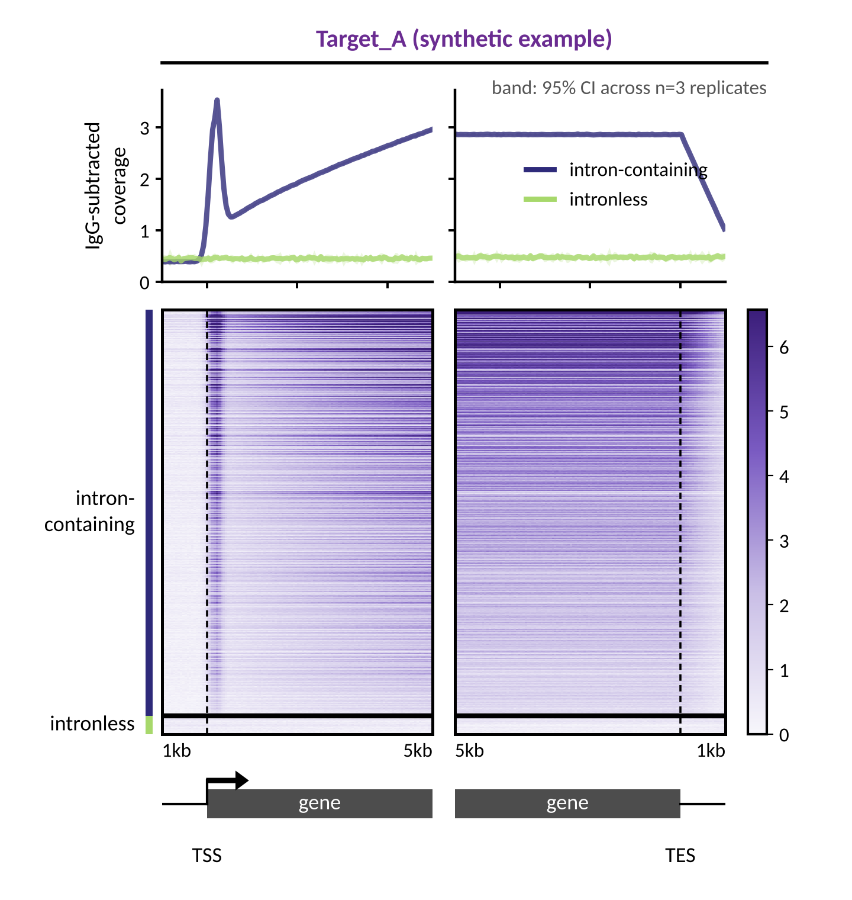

# Split metagene figure (TSS / TES anchored) for CUT&RUN - host genome

Authors : Katharina (Nina) Hayer, co-created with Claude Fable 5.1 (Anthropic)
Version : 1.3.0  |  Date: 2026-11-24

Reproduces the "intron-containing vs intronless" panel style: mean profile on
top, row-grouped heatmap below, one panel anchored at the TSS (-1 kb .. +5 kb)
and one at the TES (-5 kb .. +1 kb), with a single shared row order.



*Synthetic example, not a result.* Regenerate it with:

```bash
python3 make_synth_matrix.py --prefix synthetic_demo
python3 plot_split_metagene.py --tss synthetic_demo.TSS.mat.gz \
    --tes synthetic_demo.TES.mat.gz --signal subtract \
    --title "Target_A (synthetic example)" --out synthetic_demo
```

`make_synth_matrix.py` writes real deepTools computeMatrix files filled with
invented signal, so the plotter can be demonstrated and tested without any
experimental data. Its group sizes mirror the real imbalance on purpose - 900
intron-containing against 40 intronless - because a demo with two equal bands
would misrepresent what the figure looks like on real input.

## Group sizes and `--min-length`

`--min-length` and the intronless group pull against each other. Intronless
protein-coding genes are short as a class, so a high length floor removes most
of them: on a GENCODE-style human annotation with `--min-length 6000` and
`--neighbour-filter tss`, the intronless group came out at 22 genes against
13,163 intron-containing. deepTools then prints

```
One of the groups defined in the bed file is too small.
```

which it does whenever the smaller group is <= 0.2% of all regions. Nothing is
dropped and no exception is raised - but a 22-gene average is gene sampling,
not a class difference, and the two curves should not be compared.

`make_gene_groups.py` (>= 1.1.0) prints the per-group cost of the length filter
and a sweep over candidate thresholds, so the trade can be read off directly:

```
dropped (< 6000 bp): <n> (<n> intron-containing, <n> intronless)
min-length sweep (before --neighbour-filter):
  >=   1000 bp:   <n> intron-containing,  <n> intronless
  >=   2000 bp:   <n> intron-containing,  <n> intronless
  >=   6000 bp:   <n> intron-containing,  <n> intronless  <- current
```

Lowering the floor means lowering the windows with it. The TSS window spans
`-tss_up .. +tss_down` and the TES window `-tes_up .. +tes_down`, so the two
only stop sharing sequence once a gene is at least `tss_down + tes_up` long -
10 kb at the defaults, not 6 kb. Genes between the floor and that length are
plotted in both panels over part of their body; that is a normal metagene
compromise, but it is the thing being traded for a usable intronless n.

## Inputs you already have

* Signal bigWig from the pipeline. For a host-only, IgG-corrected view use
  `results_<condition>_final/03_peak_calling/07_bigwig_minus_igg/<sample>.bigWig`
  (or `03_bed_to_bigwig/` for the plain spike-in-normalized track).
* A GTF for the host reference used by the run (same as in the samplesheet /
  `pipeline_info/samplesheet.valid.csv` -> genome).

## Run (on the HPC, in the env that has deepTools)

```bash
# 1) gene groups (strand-aware BED6, protein-coding, >= 6 kb by default).
#    Drops chrM/chrY and, if you pass it, the Ad5 contig.
#    Read the --min-length sweep it prints before trusting the intronless curve.
python3 make_gene_groups.py /path/to/gencode.vXX.annotation.gtf.gz \
    --out-prefix genes --keep-ad5 OP218818.1

# 2) matrices + figure for one condition; ALL replicates found by glob are
#    passed to computeMatrix and averaged per gene before plotting.
#    6th arg picks the track: subtract (IgG-subtracted coverage, default)
#    or log2ratio (log2 target/IgG, symmetric blue/purple scale).
bash run_split_metagene.sh \
    ../results_<condition>_final/03_peak_calling/07_bigwig_minus_igg \
    COND_A genes.intron_containing.bed genes.intronless.bed \
    figs/COND_A_host subtract "COND_A (host, minus IgG)" 8

bash run_split_metagene.sh .../07_bigwig_minus_igg COND_B   genes.intron_containing.bed genes.intronless.bed figs/COND_B_host   subtract "COND_B (host)"   8
bash run_split_metagene.sh .../07_bigwig_minus_igg CONTROL genes.intron_containing.bed genes.intronless.bed figs/CONTROL_host subtract "control (host)" 8

# -> figs/<cond>_host.split_metagene.pdf / .png  (+ the .TSS/.TES.mat.gz)
```

For Ad5 vs Mock on one color scale, re-plot both from their matrices with the
same `--vmax` (and `--ymax` for the profiles):

```bash
for c in COND_A COND_B; do
  python3 plot_split_metagene.py --tss figs/${c}_host.TSS.mat.gz \
      --tes figs/${c}_host.TES.mat.gz --signal subtract --vmax 6 --ymax 3 \
      --title "$c (host, minus IgG)" --out figs/${c}_host.split_metagene
done
```

## Plotter options

```
plot_split_metagene.py --tss A.TSS.mat.gz --tes A.TES.mat.gz
    --title "..."           title bar
    --vmax 10               heatmap ceiling (default: 98th percentile)
    --ymax 4                profile y-axis ceiling
    --ylabel "..."          y-axis label (default: coverage-normalized counts)
    --sort-by mean|tss|tes  row order within each group
    --signal subtract|log2ratio  scale/colormap; default subtract
    --ci 95|sem|none        band around profiles when >1 replicate (default 95)
    --alpha 0.8             opacity of profile lines
    --out prefix            writes prefix.pdf and prefix.png (200 dpi)
```

## Notes

* Replicates: every `<cond>_R*.<type>.bigWig` is a separate sample in the
  matrix; the heatmap shows the per-gene mean across replicates, and the
  profile lines carry a band = 95% t-interval (df = n-1) across the
  replicate-level mean profiles. With n = 3 that interval is wide by
  construction (t = 4.30); `--ci sem` gives the tighter +/-1 SEM band.
* Window sizes come from the matrix headers, so changing `-b/-a` in the shell
  script is enough; the cartoon labels update automatically.
* Rows are sorted descending by mean signal within each group, and the SAME
  order is applied to both panels (that is what makes the two heatmaps
  comparable row-for-row).
* Fonts: Calibri where available, otherwise Carlito/DejaVu; nothing < 12 pt.
* The group split can be anything: hand two BEDs of your own to
  `run_split_metagene.sh` (e.g. DESeq2 up vs unchanged promoters) and the
  labels are taken from the BED file names.
